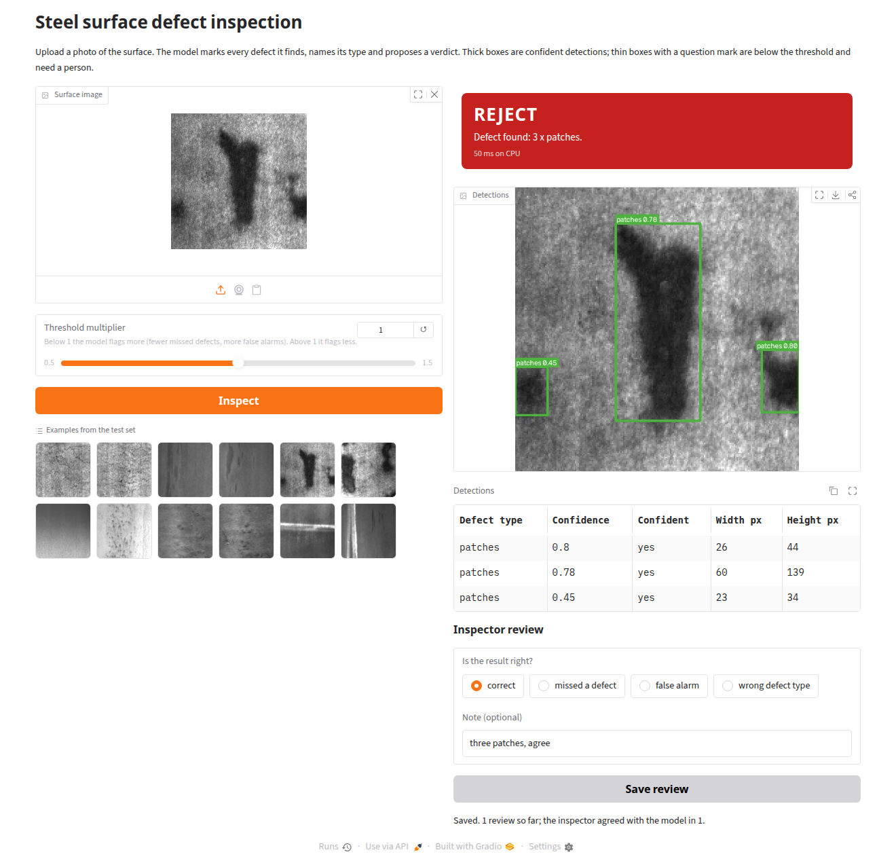
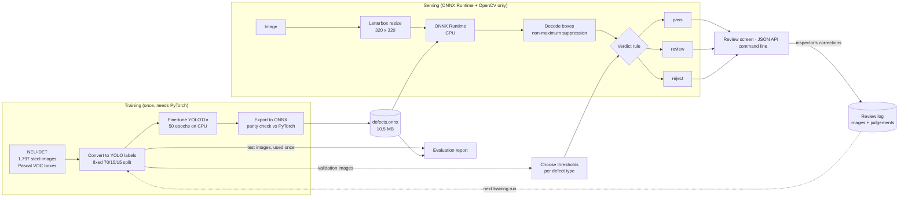
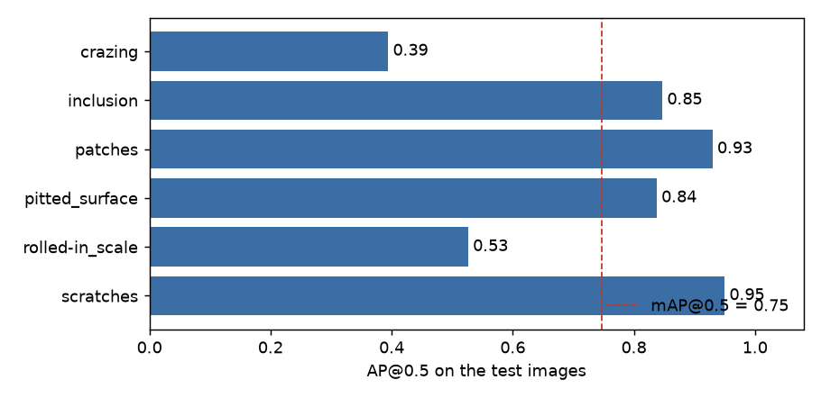
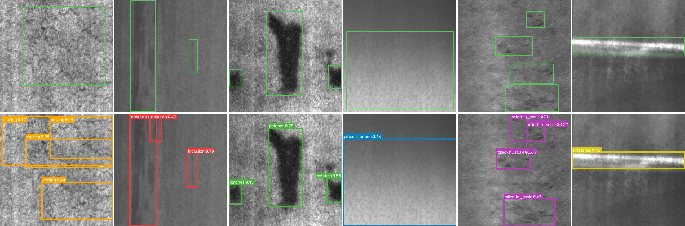

# Visual defect detection for manufacturing

Looks at a photo of a steel surface, **draws a box around every defect, names the defect type,
and tells the inspector whether the part passes, needs a second look, or is rejected.**

- A YOLO11n detector fine-tuned on 1,257 labelled steel images, measured on 270 images it never saw.
- Runs on an ordinary CPU with ONNX Runtime: about 21 ms per image, no graphics card, **no PyTorch
  on the serving machine**.
- A review screen where the inspector confirms or corrects each result. Corrections are saved with
  the image, ready to become training data for the next version.
- A JSON API for a line controller or a quality system.
- Honest numbers: a confidence interval on the headline score, the count of missed defects and
  false alarms, the two defect types it is weak on, and a classical baseline to compare against.

Works straight after cloning: the trained model (10.5 MB) and twelve sample images are in the
repository. No API key, no GPU, no paid service.



## How it works



## Results

Every number below was produced by `python -m defects.evaluate` (and `python -m defects.baseline`
for the baseline) and is written to [`reports/evaluation.md`](reports/evaluation.md) and
[`reports/metrics.json`](reports/metrics.json). The model scored is the exported ONNX file, run
through the same code that serves requests. Thresholds were chosen on the validation images; the
test images were used for nothing else.

**Held-out test set: 270 images, 626 labelled defects.**

| Metric | Value |
|---|---|
| mAP@0.5 | **0.747** (95% interval 0.720 to 0.782) |
| mAP@0.5:0.95 | 0.413 (95% interval 0.392 to 0.442) |
| Defects found at the working thresholds | 469 of 626 (recall 0.75) |
| False alarms at the working thresholds | 258 (precision 0.65) |
| Defective images rejected / sent to review / passed | 268 / 0 / 2 of 270 |
| Latency per image, CPU, including resize and clean-up | 21 ms median, 34 ms 95th percentile |
| Model file | 10.5 MB |

Latency was measured on an Intel Xeon E5-1620 v3 (a 2014 desktop processor), 810 timed calls.

### Per defect type

| Defect type | Labelled | AP@0.5 | Threshold | Precision | Recall | Found | Missed | False alarms |
|---|---|---|---|---|---|---|---|---|
| scratches | 85 | 0.950 | 0.45 | 0.918 | 0.918 | 78 | 7 | 7 |
| patches | 123 | 0.930 | 0.34 | 0.845 | 0.886 | 109 | 14 | 20 |
| inclusion | 150 | 0.847 | 0.26 | 0.728 | 0.787 | 118 | 32 | 44 |
| pitted_surface | 67 | 0.837 | 0.12 | 0.781 | 0.746 | 50 | 17 | 14 |
| rolled-in_scale | 102 | 0.526 | 0.22 | 0.573 | 0.539 | 55 | 47 | 41 |
| crazing | 99 | 0.394 | 0.08 | 0.309 | 0.596 | 59 | 40 | 132 |



Three things worth saying plainly:

- **Four defect types are solid, two are not.** Crazing and rolled-in scale are fine textures
  spread over the surface, with no clear edge. Where one "defect" ends is a matter of opinion,
  so the labelled boxes themselves are inconsistent and a box-overlap score punishes the model
  for it. Crazing alone produces half of all false alarms (132 of 258). For those two types, a
  per-image answer ("this plate has crazing") is more reliable than the exact box.
- **The model's mistakes are misses and false alarms, not wrong names.** At the working
  thresholds, no test defect was found and given the wrong type
  ([confusion matrix](docs/confusion.png)).
- **The false reject rate on good parts is unknown.** Every image in this dataset contains a
  defect. Two of 270 defective images would have passed, but how many clean plates would be
  wrongly rejected cannot be measured here. That needs images of good parts from the real line.

### Against a classical baseline

Could plain image processing do the job? The baseline subtracts a blurred background, thresholds
what remains and boxes the blobs, with its settings tuned on the validation images. It cannot
name defect types, so both methods are scored on finding a defect of any type.

| Method | AP@0.5, any type | 95% interval |
|---|---|---|
| OpenCV background subtraction, no training | 0.094 | 0.074 to 0.125 |
| **Fine-tuned YOLO11n (ONNX)** | **0.786** | 0.751 to 0.819 |

### The export is faithful

On 60 validation images the PyTorch model and the ONNX detector in this repository return the
same 107 boxes, all matched, with a largest confidence difference of 0.0
([`reports/parity.json`](reports/parity.json), produced by `python -m defects.export`).

### What it looks like

Top row: the boxes drawn by the people who labelled the dataset. Bottom row: the model's output
on the same test images (one per defect type: crazing, inclusion, patches, pitted surface,
rolled-in scale, scratches). Thin boxes with a question mark are below the threshold.



## Quick start

Needs Python 3.12. No key, no GPU, no dataset download.

```bash
git clone https://github.com/BelAnas/vision-defect-detection.git
cd vision-defect-detection
python -m venv .venv && source .venv/bin/activate
pip install -r requirements.txt

pytest -q                              # 69 tests
python -m defects.cli data/samples     # inspect the twelve sample images
python -m defects.app                  # review screen and API on http://127.0.0.1:7860
```

Real output of `python -m defects.cli data/samples`:

```text
crazing_101.jpg              REJECT     36 ms  Defect found: 4 x crazing.
crazing_11.jpg               REJECT     29 ms  Defect found: 6 x crazing.
inclusion_102.jpg            REJECT     35 ms  Defect found: 3 x inclusion.
inclusion_117.jpg            REJECT     22 ms  Defect found: 4 x inclusion.
patches_109.jpg              REJECT     25 ms  Defect found: 3 x patches.
patches_128.jpg              REJECT     22 ms  Defect found: 4 x patches.
pitted_surface_10.jpg        REJECT     22 ms  Defect found: 1 x pitted_surface.
pitted_surface_113.jpg       REJECT     21 ms  Defect found: 2 x pitted_surface.
rolled-in_scale_102.jpg      REJECT     26 ms  Defect found: 4 x rolled-in_scale.
rolled-in_scale_109.jpg      REJECT     25 ms  Defect found: 4 x rolled-in_scale.
scratches_101.jpg            REJECT     21 ms  Defect found: 1 x scratches.
scratches_110.jpg            REJECT     25 ms  Defect found: 2 x inclusion, 1 x scratches.
```

All twelve are rejected because all twelve are defective: the dataset has no good parts.

### The API

```bash
curl -s -F file=@data/samples/scratches_101.jpg http://127.0.0.1:7860/api/detect
```

```json
{
  "file": "scratches_101.jpg",
  "verdict": "reject",
  "reason": "Defect found: 1 x scratches.",
  "detections": [
    {"label": "scratches", "class_id": 5, "confidence": 0.7161,
     "x1": 0.0, "y1": 67.9, "x2": 200.0, "y2": 97.6, "confident": true}
  ],
  "latency_ms": 50.2,
  "image": {"width": 200, "height": 200},
  "thresholds": {"crazing": 0.08, "inclusion": 0.26, "patches": 0.34,
                 "pitted_surface": 0.12, "rolled-in_scale": 0.22, "scratches": 0.45,
                 "review_floor": 0.08}
}
```

| Endpoint | What it does |
|---|---|
| `GET /api/health` | Model file, classes and thresholds in use |
| `POST /api/detect` | Multipart `file` (JPEG, PNG, BMP, TIFF, up to 10 MB), optional `sensitivity` from 0.25 to 4.0. Returns detections and a verdict |
| `GET /api/reviews/summary` | How many reviews were saved and how often the inspector agreed |
| `GET /docs` | Interactive API documentation |

Empty uploads return 400, files over 10 MB return 413, and files that are not images return 415.

### The verdict rule

| Verdict | When |
|---|---|
| **reject** | At least one box at or above the confidence threshold of its defect type |
| **review** | Only weaker boxes, above the review floor: a person should look |
| **pass** | Nothing above the review floor |

The rule is one function, `verdict_for` in [`defects/service.py`](defects/service.py). A plant
would replace it with its own acceptance standard (defect type, size, zone).

## Retraining

Only needed to rebuild the model or to train on other images. This part needs PyTorch.

```bash
pip install -r requirements-train.txt
python scripts/download_data.py    # NEU-DET from Hugging Face, pinned revision, about 28 MB
python -m defects.baseline         # the OpenCV baseline
python -m defects.train            # 50 epochs, about 82 minutes on 8 CPU cores
python -m defects.export           # ONNX file, model card, parity check
python -m defects.evaluate         # thresholds, metrics, report and figures
```

The published model took 81.7 minutes to train on CPU. Training on CPU is not bit-for-bit
repeatable across machines, so a retrained model will score close to, not exactly, the numbers
above.

## Configuration

| Variable | Default | Meaning |
|---|---|---|
| `DEFECTS_MODEL` | `model/defects.onnx` | Path to another ONNX model with the same output layout |
| `DEFECTS_CONFIDENCE` | from `model/thresholds.json` | One confidence threshold for every defect type, overriding the file |
| `DEFECTS_REVIEW_DIR` | `reviews/` | Where the review log and reviewed images are stored |
| `HOST`, `PORT` | `127.0.0.1`, `7860` | Where the server listens |

## Project structure

```text
defects/
  config.py      paths, class names, dataset revision
  data.py        Pascal VOC to YOLO conversion, stratified split
  metrics.py     IoU, average precision, mAP, bootstrap interval, confusion matrix (NumPy)
  baseline.py    the classical OpenCV baseline
  train.py       fine-tuning with Ultralytics (training only)
  export.py      ONNX export, model card, parity check against PyTorch (training only)
  detector.py    ONNX Runtime inference: letterbox, decoding, non-maximum suppression
  service.py     thresholds, verdict rule, drawing
  evaluate.py    thresholds from validation, metrics on test, report and figures
  reviews.py     the inspector's review log
  app.py         FastAPI endpoints and the Gradio review screen
  cli.py         command line
scripts/download_data.py   downloads and prepares the dataset
model/           defects.onnx, model card, thresholds
data/            split lists, twelve sample images, dataset notes
reports/         metrics, evaluation report, training history, baseline, parity
docs/            figures and the screenshot
tests/           69 tests
```

## Limits

- **Public benchmark, not a production line.** The images are 200 x 200 grey crops of hot-rolled
  steel from one source. A real camera, lighting and material will need new labelled images and
  retraining. The method transfers; the model file does not.
- **No good parts in the data.** The false reject rate on defect-free surfaces is not measured,
  and the thresholds were tuned without any clean images. The crazing threshold in particular
  (0.08) is low and would probably need raising once good parts are available.
- **Two weak defect types.** Crazing (AP 0.39) and rolled-in scale (AP 0.53) are not reliable at
  box level.
- **Training stopped at a CPU budget.** The validation score was still rising slowly at epoch 50.
  One run, one seed: the spread between runs was not measured.
- **Small test set.** 270 images, hence the confidence intervals. The split is random, not by
  production batch, because the dataset has no batch information.
- **The verdict rule is generic.** Any confident defect rejects the part. Real acceptance
  standards depend on defect size and position, which needs a pixel-to-millimetre calibration.
- **Latency is for one small image at a time.** A 5-megapixel line camera would need tiling or a
  larger input, and the speed would have to be measured again.
- **The review screen has no login** and the review log is a local CSV file with images.
- **Licences.** See below: the model file is AGPL-3.0 and the dataset has no stated licence.

## Licences

- **Code:** MIT, see [`LICENSE`](LICENSE).
- **Model file `model/defects.onnx`:** AGPL-3.0. It was trained with Ultralytics YOLO, whose
  licence extends to trained models. For a closed-source product, either buy an Ultralytics
  Enterprise licence or retrain with a permissively licensed detector; the data preparation,
  metrics, evaluation, serving code and review screen in this repository do not depend on
  Ultralytics. Details in [`model/README.md`](model/README.md).
- **Dataset:** NEU-DET, Northeastern University (K. Song, Y. Yan). Published for research with a
  request to cite and no stated licence. Only twelve sample images are included here, for
  demonstration. Citations and details in [`data/README.md`](data/README.md).
